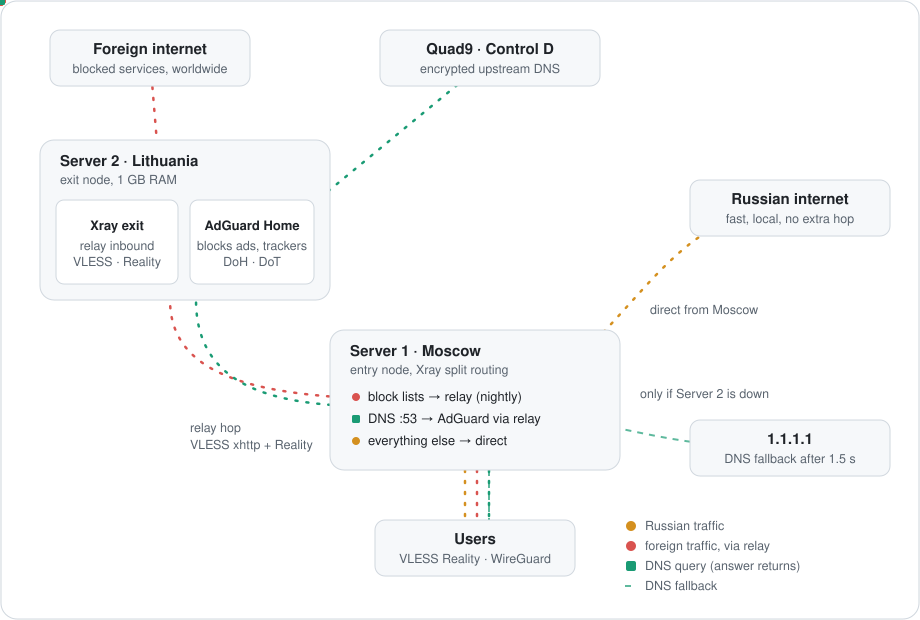

# Homelab

Two small VPS servers and a home Hyper-V host, managed as code.

The servers run a two-hop VPN (Xray / 3x-ui) for family and friends who just press "on" in the
app. **Server 1** (Moscow) is the entry point and splits traffic: Russian sites go out directly,
blocked services go over a relay to **Server 2** (Lithuania), the exit node. Server 2 also runs
AdGuard Home, so everyone's DNS is filtered. Everything heavy (Ansible, Git, monitoring, test VMs)
runs at home and reaches the servers over a separate management WireGuard network. SSH, panels
and metrics are never exposed to the internet.

## How traffic flows

- **Users** only ever talk to one address. Server 1's split routing decides per connection: a
  hand-made list of blocked services, plus Russia's public block list (refreshed nightly,
  [ADR 0008](docs/adr/0008-relay-by-block-list.md)), goes over the relay; everything else stays
  local and fast.
- **New users in seconds:** a Telegram button creates a person's WireGuard inbound and sends the
  `.conf` and a QR code; add devices, resend, disable or delete the same way. Applied live, no
  restart ([ADR 0010](docs/adr/0010-users-from-telegram.md)).
- **Checked, not assumed:** agents on both servers test sites from Moscow, through the users' own
  routing, and from Lithuania. A Telegram bot answers `/check site.com`, and an alert fires when
  users can't open a site that Lithuania can ([ADR 0007](docs/adr/0007-reachability-checker.md)).
- **The relay hop** is VLESS over xhttp with Reality, and pretends to be Server 2's own small
  website, so name, address and certificate all match ([ADR 0006](docs/adr/0006-reality-camouflage.md)).
- **DNS** from Server 1 users is caught on port 53 and sent through the relay to AdGuard Home's
  DNS-over-HTTPS. AdGuard blocks ads and trackers, then asks Quad9 / Control D over encrypted DNS.
- **Reliability over cleverness:** if Server 2 is down for maintenance, Server 1 answers DNS from
  1.1.1.1 after 1.5 s and Russian traffic keeps working. Users never have to change anything
  ([runbook 05](docs/runbooks/05-moscow-dns-via-adguard.md), [ADR 0004](docs/adr/0004-per-user-dns-identity.md)).

## How changes ship, and how it recovers

- **Deploy.** Every push is linted in GitHub Actions. Ansible applies roles to the Hyper-V staging
  VM first, then Server 2, then Server 1, one host at a time, over the management network as the
  `ops` user (root login is off). Firewall changes arm a dead-man switch that rolls them back after
  20 minutes unless access is proven.
- **Recover.** Nightly backups of panel databases and configs are pulled home and packed into an
  encrypted, versioned recovery kit on Google Drive (restic). One password in a password manager
  opens everything: SSH keys, vault, repository, server backups. A monthly drill rebuilds staging
  from the kit; a fresh VM becomes a working server in about 5 minutes
  ([runbook 08](docs/runbooks/08-recovery-kit.md), [runbook 09](docs/runbooks/09-recover-from-zero.md)).
- **Observe.** Prometheus and Alertmanager on Server 2 probe both servers from both sides and send
  Telegram alerts for services, certificates and stale backups. Server 1 watches the watcher and
  pushes to ntfy if Server 2's monitoring disappears. Grafana at home shows the history
  ([ADR 0005](docs/adr/0005-monitoring-placement.md), [runbook 07](docs/runbooks/07-monitoring.md)).

## Repository layout

| Path | Contents |
|---|---|
| `ansible/` | Inventory, variables (secrets in an encrypted vault), `site.yml`, `access.yml` |
| `ansible/roles/` | **Base:** `common`, `hardening`, `wg_mgmt`, `firewall` · **Services:** `xui`, `adguard`, `dns_identity`, `decoy_site` · **Backups:** `backup`, `recovery_kit` · **Monitoring:** `node_exporter`, `blackbox_exporter`, `monitoring`, `watcher`, `grafana`, `reach`, `reach_bot`, `xui_exporter` · **Relay list:** `geodata` |
| `scripts/` | Backup pull (`Backup-Vps.ps1`), recovery-kit task, home launcher (`Open-Homelab.ps1`), one-off migration helpers |
| `homelab-vms/` | Hyper-V VM creation (`New-LabVm.ps1`) |
| `docs/adr/` | Architecture decisions and the reasons behind them |
| `docs/runbooks/` | Step-by-step procedures, from first Ansible run to recovering from zero |
| `docs/postmortems/` | Incident write-ups |
| `docs/tests/` | Test logs: what was checked, and how |
| `.github/workflows/` | Lint pipeline (yamllint, ansible-lint, vault check) |

## Getting started

1. **Back up first.** Follow [docs/runbooks/00-inventory-and-backup.md](docs/runbooks/00-inventory-and-backup.md).
2. **Set up Ansible in WSL.** Follow [docs/runbooks/01-first-ansible-run.md](docs/runbooks/01-first-ansible-run.md).
3. **Build the staging VM** ([runbook 03](docs/runbooks/03-staging-vm.md)) and run everything there first.
4. **Then Server 2, then Server 1**, one host at a time.

## Safety rules

1. Before any SSH or firewall change: keep a second session open and check the provider's web console works.
2. Every change runs on `vm-staging` first.
3. Commit before applying, so there is always a known-good version.
4. Secrets live only in the encrypted vault. No real IPs, UUIDs, keys, domains or client names anywhere else.
